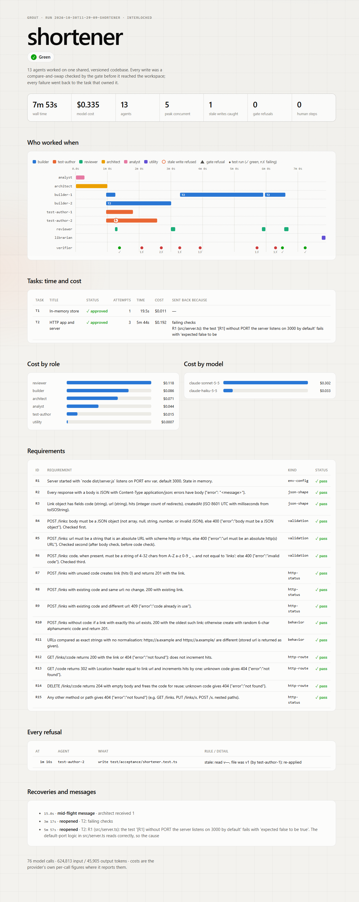
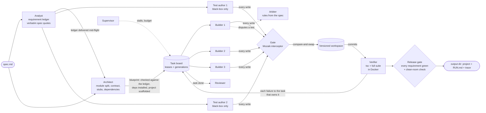

# grout

**A software factory on [Mozaik](https://github.com/jigjoy-ai/mozaik): a team of concurrent agents turns a one-page spec into a tested TypeScript CLI or HTTP API, and never loses each other's work.**

```
npm run grout -- run spec.md --out hidden/my-spec
```

Analyst and architect start together; builders and test authors work at the same time on one shared codebase; a reviewer, a verifier and an arbiter check the work while it is being written; a release gate refuses to call anything done until every requirement in the spec is covered by a passing black-box test and a clean `npm ci && npm run build && npm test` succeeds in a fresh Linux container. Every run leaves a trace with the time and the cost of every task.



## Why

Once two agents edit the same codebase, the codebase is shared mutable state. The classic failure is the **lost update**: builder A reads `src/routes.ts`, builder B reads it too, A writes its route in, B writes its own and silently erases A's. Nothing crashes. A test fails much later, if a test exists at all, and nobody knows why.

grout treats the codebase like a database. Every file has a version, every agent has the version it last read, and every write is a **compare-and-swap**: written on top of a stale read, it is refused, and the agent is handed the current content to re-apply its change on. The check and the write are one synchronous step inside the workspace, and a Mozaik interceptor enforces who may write what before the call ever reaches a tool.

Measured with real agent loops, the real gate and the real workspace, only the model scripted (`npm run grout -- race`, 500 trials per mode, 3 builders registering in one shared file, seed 1):

| mode | lost updates | trials that lost a line | stale writes refused and re-applied | mean wall time |
|---|---|---|---|---|
| parallel, no compare-and-swap | **944** | **500 / 500** | 0 | 52 ms |
| parallel, interlocked (grout) | **0** | **0 / 500** | 1306 | 98 ms |
| one builder at a time | 0 | 0 / 500 | 0 | 131 ms |

The interlock keeps every update and is still faster than going one at a time. It also fires in real runs with live models: in the recorded example two test authors wrote the same test file at the same moment; the second write was refused, re-applied on top of the first, and both sets of tests survived.

## Results on unseen specs

Eight practice specs (four CLIs, four HTTP APIs, each a page long, with exact output formats, exit codes, validation messages, persistence, pagination, rate limits). Each has a **hidden acceptance suite written independently of the factory**, which the factory never sees, run afterwards against what it produced (`npm run grout -- bench`). All runs used the economy preset (Sonnet 5.5 plans and reviews, Haiku 5.5 builds and writes tests), Docker sandbox, one candidate, no human input; each spec was run once. **139 of 139 hidden tests pass, all eight releases green, $2.66 in total.**

<!-- bench-table -->
| spec | kind | hidden tests | release | human steps | time | cost | agents | peak concurrent | stale writes caught | gate refusals | tasks sent back |
|---|---|---|---|---|---|---|---|---|---|---|---|
| hello | CLI | 8/8 | green | 0 | 67 s | $0.095 | 6 | 4 | 0 | 1 | 0 |
| hitcount | HTTP | 12/12 | green | 0 | 366 s | $0.369 | 18 | 5 | 0 | 0 | 3 |
| inventory | HTTP | 24/24 | green | 0 | 584 s | $0.988 | 27 | 6 | 0 | 0 | 6 |
| kv | HTTP | 18/18 | green | 0 | 219 s | $0.201 | 8 | 5 | 1 | 0 | 0 |
| semver | CLI | 16/16 | green | 0 | 327 s | $0.221 | 10 | 8 | 1 | 0 | 0 |
| shortener | HTTP | 18/18 | green | 0 | 473 s | $0.335 | 13 | 5 | 1 | 0 | 2 |
| todo | CLI | 18/18 | green | 0 | 266 s | $0.224 | 10 | 6 | 1 | 0 | 0 |
| wordfreq | CLI | 25/25 | green | 0 | 260 s | $0.230 | 15 | 7 | 1 | 0 | 2 |
| **total** | | **139/139** | 8/8 green | 0 | | **$2.664** | | | 5 | 1 | 13 |
<!-- /bench-table -->

The hidden suites are checked against negative controls: for two specs a deliberately wrong implementation (`bench/fixtures/wrong-*`) fails exactly on its planted bugs while the reference passes everything. Full numbers and how to reproduce them: [BENCHMARKS.md](BENCHMARKS.md).

## How a run works

Everything is a participant on one Mozaik bus. Nobody calls a builder: participants react to events and share one `RuntimeState`.



1. **Analyst ∥ Architect.** The analyst turns the spec into a *ledger*: one requirement per observable behaviour, each with the exact sentence of the spec it comes from and the spec's own examples. At the same time the architect splits the program into 2–4 tasks with disjoint files, writes the shared types and compiling stubs, and picks dependencies. The ledger reaches the architect while it is still working (delivered into its context by the gate), and the blueprint is accepted only when every requirement belongs to a task and the dependencies actually install.
2. **Builders and test authors start together.** Builders lease tasks from the board and implement them; test authors write acceptance tests from the ledger and the spec alone. They are not allowed to read `src/`: the gate refuses it and the rule is written in their tool descriptions.
3. **Checked while being written.** The verifier runs the typecheck and the whole suite on every change and sends each failure to whoever can fix it: the task owning the file in the stack trace, the task owning the requirement, or the author of a broken test. A finished task goes to a reviewer while the others keep working. A builder who believes a test contradicts the spec disputes it, and an arbiter rules from the spec text.
4. **Released only when it is true.** Green means: every testable requirement has tests and they pass, every task is approved, and a fresh container can install, build and test the project from its lockfile. Otherwise the factory still exports its best state, labelled *incomplete*, with the exact requirements that block it.

With `--candidates 2` two independent teams build the same ledger in parallel. Each team's acceptance tests then run against the other team's program; where the winner fails the other team's test, an arbiter decides from the spec, and when the code is wrong the winner adopts that test and fixes the bug.

## Mozaik, used for what it is for

| Mozaik primitive | In grout |
|---|---|
| `InterceptionHandler` | the gate: write ownership, locked project files, black-box isolation, budget, stop and step limits; queued messages delivered into a running agent's context before its next inference |
| `FunctionCallItem.rehydrate` | refusals answered in place of the tool; empty arguments repaired before the runtime parses them |
| `RuntimeState` | the shared `FactoryState`: versioned workspace, ledger, board, test matrix, budget |
| Semantic events + situation handlers | broker, verifier, review desk, supervisor, conductor, tracer, librarian are participants reacting to events |
| One agent loop per attempt | a reopened task starts from a fresh context with the feedback history, never from a confused one |
| `@mozaik-ai/cloud-sdk` | optional: the whole run as one Mozaik Cloud session |

What we learned about the runtime on the way, with source references, is in [MOZAIK-NOTES.md](MOZAIK-NOTES.md).

## It notices its own mistakes

- **Lost updates** become stale refusals that the agent recovers from on its own.
- **Failing checks** are routed to the owning task; the task is reopened with the failure and the requirement's spec quote, and the next attempt starts fresh.
- **A task that keeps failing** gets a stronger model on its third attempt; a test that keeps failing is sent to the arbiter automatically, because sometimes the test is what is wrong.
- **Stalls**: the supervisor stops an agent that has gone quiet; its task is reopened.
- **The environment** (registry timeouts, a corrupted npm cache, a port collision) is fixed by an environment doctor without costing a builder an attempt.
- **Requirements nobody tested** go back to the test author who owns them.
- **Memory**: after a run with problems, a small agent distils a few general lessons; the next run recalls them into the architect's and builders' instructions (mem0 when `MEM0_API_KEY` is set, a local file otherwise).

## Transparency

Each run writes `runs/<id>/trace.jsonl` (every bus event, every model call with tokens, cost and latency, every refusal, every sandbox command) and a self-contained `report.html`: who worked when, each task's time, cost, attempts and why it was sent back, cost by role and model, the requirement matrix, and every refusal. The output directory gets the same trace and report under `grout-run/`, a `RUN.md` and a `HUMAN_STEPS.md`.

```
npm run grout -- replay examples/shortener/grout-run     # replays the recorded run in the terminal, no key needed
open examples/shortener/grout-run/report.html
```

## Run it

Requirements: Node 20+ (developed on 24), an API key for one provider, Docker (optional; without it commands run locally).

```
npm install
cp .env.example .env            # put your key in
npm run grout -- doctor         # checks Node, Docker and the provider
npm run grout -- run bench/specs/hello.md --out out/hello
```

`npm run build` compiles the CLI to `dist/`; `node dist/cli.js` is then the same command.

| variable | meaning |
|---|---|
| `VENICE_API_KEY` | Venice (default provider; Claude models through an OpenAI-compatible API) |
| `OPENROUTER_API_KEY` | OpenRouter |
| `ANTHROPIC_API_KEY` / `OPENAI_API_KEY` | the runtime's own Anthropic / OpenAI endpoints |
| `GROUT_PROVIDER` | force a provider when several keys are set |
| `GROUT_PLANNER_MODEL`, `GROUT_BUILDER_MODEL`, `GROUT_UTILITY_MODEL` | override a model tier |
| `GROUT_BASE_URL` + `GROUT_API_KEY` | any other OpenAI-compatible endpoint (set all three model variables) |
| `MEM0_API_KEY` | cross-run lessons in mem0 (otherwise `~/.grout/lessons.json`) |
| `GROUT_MOZAIK_KEY` | export the run to Mozaik Cloud |

| command | |
|---|---|
| `grout run <spec> [--out dir] [--candidates 1\|2] [--builders 3] [--test-authors 2] [--budget 2] [--deadline HH:MM] [--sandbox auto\|docker\|local] [--mode interlocked\|naive\|sequential] [--quality economy\|quality] [--note "..."] [--commit]` | build a spec |
| `grout replay <runDir>` | replay a recorded run in the terminal |
| `grout report <runDir>` | rebuild a run's HTML report from its trace |
| `grout nudge <runDir> "<message>"` | the only way for a person to step in during a run; delivered to the running agents and logged in `HUMAN_STEPS.md` |
| `grout bench [--specs a,b] [--build]` | run the hidden acceptance suites against outputs |
| `grout race [--runs 500]` | the zero-token lost-update experiment |
| `grout doctor` | environment check |

The run stops when `--budget` (USD) is spent or `--deadline` is reached, and exports the best state so far, labelled.

## The project it produces

TypeScript, ESM, Node 20+, built by `tsc` into `dist/`, tested with vitest through a generated black-box harness that starts the program exactly as the spec says it is run (`node dist/x.js`, `npm start --`, a `bin` command, a port variable with its default). `dist/` and `package-lock.json` are committed, so the project runs whether it is started with `npm ci && npm run build`, with `npm ci` alone, or straight from `dist/`. Where the spec says otherwise, the spec wins.

## Tests

```
npm test                                           # 140+ unit and integration tests, no network, no tokens
GROUT_DOCKER_TESTS=1 npm test                      # + the Docker sandbox
GROUT_SLOW_TESTS=1 npm test                        # + generated projects built and tested for real, and full scripted runs (one and two candidates)
```

The scripted runs use a zero-token inference runner that plays every role, so the whole factory (ledger, blueprint, scaffold, builders, test authors, review, verifier, clean room, export) is exercised without a model.

## Honest limits

- **Small specs only.** grout is tuned for one-page specs: a handful of tasks, minutes per run. It does not plan large codebases.
- **One process.** Agents are concurrent loops in one Node process (Mozaik's model); commands run in Docker containers.
- **Black-box tests only see what the spec states.** If the spec is silent, the analyst chooses the most literal reading and records it; a hidden test that expects a different reading can still fail.
- **Non-functional requirements** (speed, style) cannot be tested black-box: they are listed in `RUN.md`, not gated.
- **Cost figures** are the provider's own per-call numbers where it reports them (Venice does); otherwise they are computed from a price table and marked as estimates.
- **Two candidates cost roughly three times one** (the second team builds on the stronger model); cross-checking runs one round.

## License

MIT
